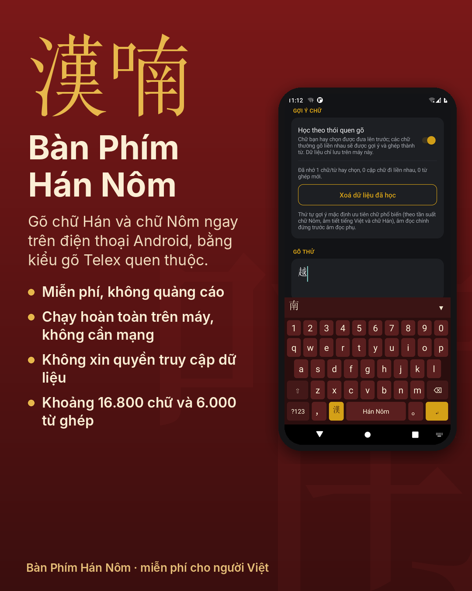
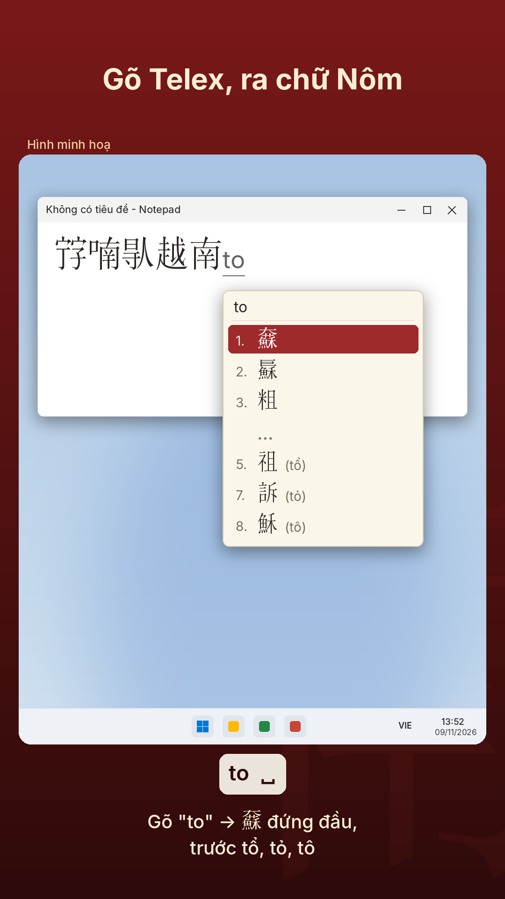
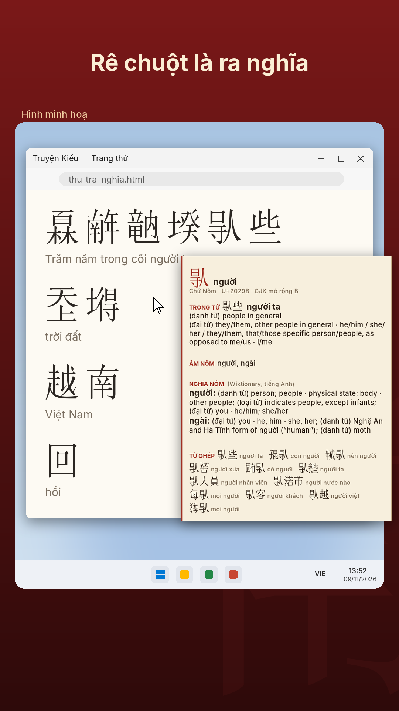

# 𡨸喃 Bàn phím Hán Nôm

**Công cụ số miễn phí, mã nguồn mở giúp người Việt gõ, đọc và hiểu chữ Nôm.**

Dự án gồm ba sản phẩm dùng chung một kho dữ liệu:

| Sản phẩm | Nền tảng | Phiên bản | Thư mục |
|---|---|---|---|
| **Bàn phím Hán Nôm** — gõ chữ Hán, chữ Nôm bằng Telex, gợi ý thông minh, tự học thói quen, nhấn giữ để xem nghĩa | Android 5.0+ | 1.4.1 | [`android/`](android/) |
| **Bàn phím Hán Nôm** — kiểu gõ Hán Nôm cho bộ gõ Weasel (Rime), dùng được ở mọi ứng dụng | Windows 10 / 11 | 1.2 | [`windows-ime/`](windows-ime/) |
| **Tra Nghĩa Hán Nôm** — từ điển nổi: rê chuột lên chữ Hán/Nôm ở bất kỳ ứng dụng nào để xem âm đọc và nghĩa | Windows 10 / 11 | 1.4.1 | [`tra-nghia/`](tra-nghia/) |

Tất cả đều **miễn phí, không quảng cáo, chạy hoàn toàn trên máy, không cần mạng, không thu thập dữ liệu.**

<p align="center">
  
  
  
</p>

## 📥 Tải về

| Sản phẩm | Tải trực tiếp |
|---|---|
| Bàn phím Hán Nôm cho **Android** | [BanPhimHanNom-1.4.1.apk](https://github.com/buitrunghieua2-coder/ban-phim-han-nom/raw/main/tai-ve/BanPhimHanNom-1.4.1.apk) |
| Bàn phím Hán Nôm cho **Windows** (cần cài [Weasel](https://github.com/rime/weasel/releases) trước) | [BanPhimHanNom-Windows-1.2.zip](https://github.com/buitrunghieua2-coder/ban-phim-han-nom/raw/main/tai-ve/BanPhimHanNom-Windows-1.2.zip) |
| Từ điển nổi **Tra Nghĩa Hán Nôm** cho Windows | [TraNghiaHanNom-1.4.1.zip](https://github.com/buitrunghieua2-coder/ban-phim-han-nom/raw/main/tai-ve/TraNghiaHanNom-1.4.1.zip) |

Hướng dẫn chi tiết: thư mục [`tai-ve/`](tai-ve/), tệp `HUONG-DAN.txt` trong mỗi gói, và [video hướng dẫn](docs/video/).

**Lưu ý:** các bản Windows chưa có chữ ký số, nên Windows có thể hiện cảnh báo "Windows đã bảo vệ PC của bạn". Chọn **Thông tin bổ sung → Vẫn chạy**.

## Vì sao có dự án này

Chữ Nôm là hệ chữ do người Việt sáng tạo để ghi tiếng Việt. Nhiều tác phẩm lớn như *Truyện Kiều* được viết bằng chữ Nôm: 𤾓𢆥𥪞𡎝𠊛些 (*Trăm năm trong cõi người ta*). Ngày nay rất ít người đọc được chữ Nôm, phần lớn chữ Nôm nằm ở các vùng mở rộng của Unicode mà ít bộ gõ hỗ trợ, và nhiều bàn phím Hán Nôm trên kho ứng dụng đang thu phí. Dự án mong để ai cũng có thể gõ và hiểu chữ Nôm, miễn phí, ngay trên thiết bị mình dùng hằng ngày.

## Cấu trúc kho mã

```
android/       Ứng dụng bàn phím Android (Java, build không cần Gradle)
windows-ime/   Kiểu gõ Hán Nôm cho Weasel/Rime: schema, bộ lọc Lua, bộ cài .bat, công cụ dựng từ điển
tra-nghia/     Từ điển nổi Tra Nghĩa (C++ / Win32, UI Automation, Direct2D/DirectWrite)
data/          Dữ liệu dùng chung: dict.txt (từ điển gõ), nghia.txt (giải nghĩa), phông chữ, nguồn gốc, công cụ dựng
docs/          Hình ảnh, video giới thiệu và hướng dẫn
tai-ve/        Tệp cài đặt đã đóng gói sẵn (APK, gói Windows, Tra Nghĩa)
```

Mỗi thư mục có `README.md` riêng hướng dẫn build.

## Cách dự án được làm

Dự án do **Bùi Trung Hiếu** khởi xướng và chủ trì: đề ra ý tưởng và mục tiêu, quyết định tính năng và thiết kế, kiểm thử trên thiết bị thật, phát hiện lỗi, xây dựng nội dung truyền thông. Mã nguồn, xử lý dữ liệu, hình ảnh và video được thực hiện **với sự hỗ trợ của trợ lý trí tuệ nhân tạo Claude (Anthropic)**, theo định hướng và phản hồi của tác giả. Lịch sử các phiên bản xem tại [CHANGELOG.md](CHANGELOG.md).

## Góp ý và đóng góp

- Báo lỗi, đề xuất tính năng hoặc sửa nghĩa: mở một [Issue](https://github.com/buitrunghieua2-coder/ban-phim-han-nom/issues). Với Tra Nghĩa, nên gửi kèm nhật ký chi tiết (xem `HUONG-DAN.txt`).
- Đóng góp mã hoặc dữ liệu: gửi Pull Request. Khi gửi, bạn đồng ý cho phép phần đóng góp được phát hành theo giấy phép của dự án.

## Giấy phép

| Phần | Giấy phép |
|---|---|
| Mã nguồn (`android/`, `windows-ime/`, `tra-nghia/`, các công cụ) | [GNU GPL v3.0](LICENSE) |
| Dữ liệu (`data/dict.txt`, `data/nghia.txt`) | [CC BY-SA 4.0](data/LICENSE) |
| Hình ảnh, video, tài liệu (`docs/`) | [CC BY 4.0](docs/LICENSE.md) |
| Phông Nom Na Tong (`data/fonts/`) | MIT, © Vietnamese Nôm Preservation Foundation |

Copyright © 2026 **Bùi Trung Hiếu và Dự án Bàn phím Hán Nôm**.

Dự án dùng dữ liệu và phần mềm của nhiều tác giả khác. Danh sách đầy đủ và giấy phép từng nguồn: **[NGUON-VA-GIAY-PHEP.md](NGUON-VA-GIAY-PHEP.md)**. Xin chân thành cảm ơn các tác giả.

---

*Để chữ của cha ông còn được đọc, được viết mỗi ngày.*
